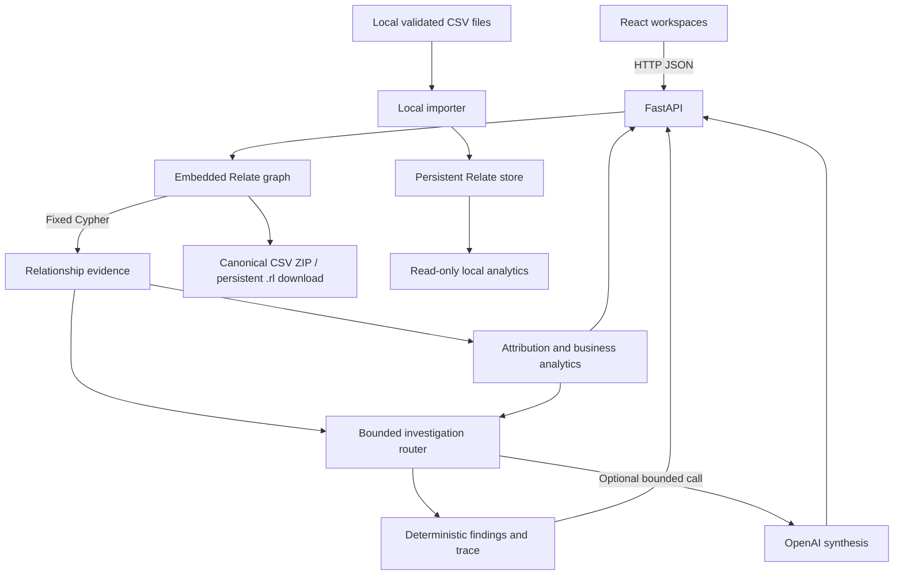

# OpenClaw Nexus — architecture and operations

## Runtime flow

The live application creates and closes an isolated in-memory graph for each analytical request. No persistent shared writes occur. The persistent file download is created in a temporary directory, committed, closed and returned. Imported local stores are separate from the hosted dashboard.

## Stored schema

| Node | Properties |
|---|---|
| Customer | id |
| Touchpoint | id, at |
| Campaign | id, name, channel, spend |
| Product | id, name, price, cost, stock |
| Order | id, at, revenue |

Relationships: Customer HAS_TOUCH Touchpoint; Touchpoint FROM_CAMPAIGN Campaign; Campaign PROMOTES Product; Customer PLACED Order; Order CONTAINS Product.

Orders contain one product unit each. The campaign's promoted product need not equal the purchased product. A product can be shared by multiple campaigns. Customer identities are synthetic and pre-linked; no identity resolution is performed.

## Module map

| Module | Responsibility |
|---|---|
| graph.py, network.py | Relate lifecycle, schema, seed, fixed Cypher and exact graph records |
| attribution.py | Pre-existing allocation engine; five models, 30-day lookback, 7-day decay half-life |
| finance.py, inventory.py | Recorded financial reconciliation and unique product stock |
| intelligence.py, customer_economics.py, sensitivity.py | Paths, historical customer value, budget scenarios, conversion/acquisition credit and model comparisons |
| reporting.py | Validated report scopes, grouping, filtering and metrics |
| investigation.py | Deterministic tool selection, execution trace and optional synthesis |
| quota.py | Atomic SQLite rolling provider-attempt quota |
| preview_api.py, webapp/ | Primary FastAPI and React application |
| store.py, dataset_export.py, dataset_import.py | Persistent stores, canonical CSV export, validated local import |
| benchmark.py, benchmark_protocol.json | Local predefined evaluation runner |
| app.py, agent.py, advanced_views.py | Retained legacy Streamlit experience |

## Evidence and agent flow

The read-only investigation executes campaign analysis first. Depending on the question, it may also run inventory analysis, graph traversal, customer journeys, attribution sensitivity, financial analysis or budget simulation. Each completed tool has an evidence ID, returned records, fixed queries and parameters. The optional language model receives this executed trace and is instructed to ground numerical and relationship claims in evidence. Deterministic findings remain available without a key or after provider failure.

No arbitrary Cypher, write tools, autonomous external actions or autonomous LLM planning. The graph relationships describe recorded business events, not causal effects.

## API surface

| Method | Path | Purpose |
|---|---|---|
| GET | /_stcore/health | Health |
| GET | /api/overview | KPIs, risks, campaign and financial summary |
| GET | /api/audit | Attribution and model comparisons |
| GET | /api/customers | Selected synthetic customer journey and purchase credit |
| GET | /api/evidence | Allowlisted business evidence |
| GET | /api/network | Stored nodes and edges |
| GET | /api/demo-store | Persistent canonical Relate file |
| GET | /api/demo-csv | Canonical five-table CSV ZIP |
| POST | /api/reports | Validated custom report |
| POST | /api/budget | Hypothetical fixed-budget scenario |
| POST | /api/analyst | Read-only investigation |

The API does not accept arbitrary user paths or dataset uploads.

## Operational controls

One public Railway service instance runs Uvicorn with one worker. A shared rolling SQLite quota defaults to five provider attempts per minute and 50 per day; `NEXUS_REQUESTS_PER_MINUTE` and `NEXUS_REQUESTS_PER_DAY` configure these limits (zero disables provider calls). Attempts, including failures, are reserved before contacting OpenAI. A per-client-IP 15-second in-process cooldown supplements the quota. The key is server-side only. Question length is capped at 500 characters, model completion at 500 tokens, timeout 25 seconds, no retries, and completion storage disabled. Provider abuse-monitoring retention may still apply.

The quota database defaults to `/tmp/nexus-quota.sqlite3`; it may reset on redeploy. Set `NEXUS_QUOTA_DB` to a mounted persistent path if persistence is desired. Multiple replicas require a shared external quota design; request limits are not a monetary cap. Use a dedicated restricted provider project and budget alerts. The benchmark runner is separate, explicitly opt-in and limited to 18 attempts per run.

Security headers, read-only queries, bounded input and dependency/credential checks support the demo. They are not a guarantee of vulnerability-free operation. See [SECURITY.md](SECURITY.md).

## Reproducibility and known boundaries

The canonical data is deterministic with seed 42. Export reads actual node properties and edges; import checks schemas, unique IDs and references, stages the database, commits, reopens and verifies before no-overwrite publication. Use synthetic data only. No public importer or dashboard dataset switching.

The full [benchmark methodology](BENCHMARK.md) records its baseline design, scoring rubric, failed initial run, actual responses and provisional results. All analytical formulas and original demo data are unchanged by the final documentation.
