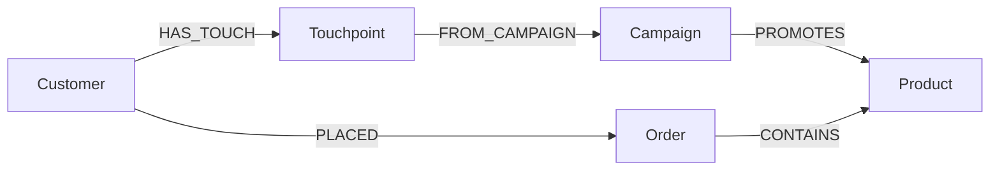

# OpenClaw Nexus

**Connected marketing intelligence: turn advertising, customer journeys, orders, costs and inventory into evidence-backed business decisions.**

Built by Tomas Corza for the [Relate by Neo4j Hackathon](https://relate.devpost.com/), November 2026.

[Live demo](https://openclaw-nexus-production-368d712a.up.railway.app/) · [Architecture](ARCHITECTURE.md) · [Benchmark](BENCHMARK.md) · [Reproduce the dataset](examples/synthetic-import/README.md) · [Submission guide](SUBMISSION.md)

**Try it now:** open the demo, select **Start guided demo**, and follow the six-step investigation. No account or API key is required to explore the deterministic functionality.

## Use case

Marketing teams often optimize revenue or ROAS without seeing whether advertised products are in stock, whether purchases generate gross profit, or how customers interacted with other campaigns. Nexus connects these records so an operator can identify risky investments, inspect why they are risky, compare attribution assumptions and evaluate controlled alternatives.

The canonical synthetic example exposes a concrete problem:

| Connected finding | Observed result |
|---|---:|
| Meta Ads / Social discovery (C2) promotes Limited edition (P2) | 3 units remaining |
| Campaign spend | $1,800 |
| Attributed profit after ads, linear model | -$301.67 |
| Profitability direction across five tested models | Loss in all five |

The graph also reveals that Search acquisition and Organic discovery promote the same Everyday kit product. Its 120 units must be counted once, not once per campaign. Customer journeys can distinguish what a customer was shown from what they actually purchased.

## How Nexus uses Relate — and why

**Relate 1.2.0 is the operational data source, not a decorative graph.** Python embeds Relate directly in the application, with no separate graph server. Fixed parameterized Cypher traverses connected marketing and commerce records; the resulting evidence feeds attribution, inventory, finance, customer analytics and the investigation agent.

- **In-memory mode:** the hosted demonstration creates a fresh isolated graph per request for predictable synthetic state and no shared writes.
- **Single-file persistent mode:** a downloadable `.rl` database allows judges to reopen and inspect the same graph without regenerating it. Local CSV import validates and rebuilds a persistent store using the same schema.
- **Why both:** the public demo remains isolated and easy to run, while the persistent artifact provides independently inspectable records and reproducibility. The dashboard does not automatically switch to imported stores.



| Node type | Count |
|---|---:|
| Customer | 80 |
| Touchpoint | 237 |
| Campaign | 4 |
| Product | 3 |
| Order | 72 |
| **Total nodes** | **396** |
| **Total relationships** | **622** |

Example actual relationship query used for inventory risk:

```cypher
MATCH (c:Campaign)-[:PROMOTES]->(p:Product)
WHERE p.stock < 10 AND c.spend > 0
RETURN c.id AS campaign_id, c.name AS campaign, c.spend AS spend,
p.name AS product, p.stock AS stock ORDER BY spend DESC
```

The investigation agent selects allowlisted tools using deterministic routing, executes real graph-derived analysis, and returns evidence IDs, results, queries and parameters. Optional OpenAI synthesis summarizes that trace; it does not generate or execute arbitrary Cypher. The offline findings remain available without a model key.

## What works

| Workspace | Capability |
|---|---|
| Overview | Business risks and recommended reviews |
| Advertising | Campaign investment, ROAS, CAC proxy and CPA |
| Revenue sources | Five attribution models, sensitivity and allocation audits |
| Profit analysis | Recorded revenue, COGS, gross profit and spend reconciliation |
| Product inventory | Unique product stock, exposure, valuation and observed purchases |
| Customer journeys | Timestamped interactions and purchase-level credit |
| Business connections | Actual relationship traversal, paths, graph exploration and data downloads |
| Budget planning | Fixed-budget hypothetical sensitivity analysis |
| AI assistant | Executed investigation trace, optional synthesis and benchmark dashboard |
| Reports | Configurable tables, charts and CSV/JSON exports |

## Setup and run

Prerequisites: Python 3.11 and Node.js 22 with npm. A compatible Relate wheel is required for the host platform; Linux x86-64 is exercised in CI. Docker is an alternative.

```bash
git clone https://github.com/Tomas-Corza/Relate-by-Neo4j-Hackathon.git
cd Relate-by-Neo4j-Hackathon
python -m venv .venv
source .venv/bin/activate
python -m pip install -r requirements-preview.txt
python -m unittest discover -s tests -v
cd webapp
npm install --no-audit --no-fund
npm run build
cd ..
python -m uvicorn preview_api:app --host 127.0.0.1 --port 8000
```

Open http://127.0.0.1:8000. Windows virtual environment activation: `.venv\Scripts\activate`.

No Neo4j server, cloud database or OpenAI API key is required. To opt into model synthesis locally, set `OPENAI_API_KEY` securely in the shell and optionally `OPENAI_MODEL` (default `gpt-4.1-mini`). Unset the key for offline use. Never commit credentials or enter private data.

Docker alternative:

```bash
docker build -t openclaw-nexus .
docker run --rm -p 8000:8000 openclaw-nexus
```

The Docker build compiles the React frontend and runs the Python tests. The legacy Streamlit interface remains available with `streamlit run app.py`; the React workspace is the primary hackathon demonstration.

## Where the persistent data lives

Download the actual canonical database from **Business Connections → Developer audit and reproducibility** or use the [direct .rl download](https://openclaw-nexus-production-368d712a.up.railway.app/api/demo-store). A binary is generated on demand rather than checked into Git. Judges can also generate an identical local graph:

```bash
python store.py create nexus-demo.rl
python store.py inspect nexus-demo.rl
python store.py export nexus-demo.rl > nexus-graph.json
```

The resulting `nexus-demo.rl` lives in the repository working directory. Inspect/export reopen it read-only. Existing files are never overwritten by creation.

To reconstruct the graph from original CSV records:

```bash
python dataset_export.py nexus-original-csv
python dataset_import.py validate nexus-original-csv
python dataset_import.py import nexus-original-csv nexus-rebuilt.rl
python dataset_import.py summary nexus-rebuilt.rl --model linear
```

The [canonical CSV ZIP](https://openclaw-nexus-production-368d712a.up.railway.app/api/demo-csv) is also available from the application. The five tables come from the original graph, not a separately maintained dataset. Round-trip tests compare all nodes and relationships, all five attribution models, financials, inventory and selected customer journeys.

Expected recorded totals: $6,970 revenue, $2,770 COGS, $4,200 gross profit, $3,150 campaign spend and $1,050 profit after ads. The 208 inventory units are counted once per product. These recorded financial totals are independent of attribution; rounded campaign credit can differ by a cent.

## Demonstration walkthrough

Start the guided demonstration on Overview:

1. Identify the low-stock Meta Ads campaign and its attributed loss.
2. Follow the actual campaign-to-product relationship in Business Connections.
3. Compare all five attribution models in Revenue Sources.
4. Run the investigation in AI Assistant and expand a returned evidence step.
5. Use Budget Planning to simulate a $300 transfer from Social discovery to Search acquisition at 50% assumed marginal efficiency. No spend is changed.
6. Generate and export a report.

The agent's own illustrative selection uses Retention email as the alternative, not Search acquisition. Both are hypothetical scenarios with explicit assumptions. For the benchmark scenario, C2 → C3 at $300 and 50% marginal efficiency gives a modeled +$285.27 in profit after ads, not a forecast.

## Experimental evaluation

A completed synthetic experiment compared six predefined questions across three context-delivery approaches, with the same resolved model (`gpt-4.1-mini-2025-04-14`) and completion cap.

| Metric | Metrics only | Context-rich flat data | Nexus |
|---|---:|---:|---:|
| Weighted answer quality | 38.33% | 89.17% | 85.42% |
| Factual accuracy | 33.33% | 83.33% | 83.33% |
| Evidence completeness | 33.33% | 91.67% | 100% |
| Total input tokens | 2,205 | 291,095 | 19,044 |
| Mean API duration | 2.145 s | 5.807 s | 3.721 s |

Nexus used **93.46% fewer input tokens** than the context-rich baseline, with equal factual accuracy and 3.75 percentage points lower weighted quality. Mean measured API duration was 35.93% lower, excluding database queries and context preparation.

**Provisional AI-assisted scoring:** independent human review is pending. This is a single trial per arm/question, on synthetic development-set questions. The flat baseline receives the same computed summaries plus raw records; optimized flat retrieval was not evaluated. The initial run failed all 18 attempts due to authentication; the second completed 18/18. Three answers reached the output cap. These results do not establish statistical significance, intrinsic graph superiority, end-to-end latency or actual billed savings.

See [BENCHMARK.md](BENCHMARK.md) for the protocol, raw responses, scoring rationale, limitations and offline reproduction. No new provider calls are necessary to verify the archived aggregate scores.

## Testing and deployment

GitHub Actions validates Python integration tests, the frontend build, full production Docker image, security checks and eight Playwright Chromium scenarios using the real local backend. The browser harness clears the API key and tests representative desktop/mobile workflows, not exhaustive cross-browser or visual behavior.

```bash
python -m unittest discover -s tests -v
cd webapp
npm run build
npx playwright install chromium
npm run test:e2e
```

[CI runs](https://github.com/Tomas-Corza/Relate-by-Neo4j-Hackathon/actions). Production is deployed on Railway using the multi-stage Dockerfile and FastAPI/Uvicorn. The public graph is synthetic and read-only; no real advertising accounts or customer data are connected.

## Original work, reused code and AI disclosure

**Author:** Tomas Corza. Nexus was developed as a new hackathon project; the public repository was created during the contest period. The earlier [Marketing OpenClaw AI framework](https://github.com/Tomas-Corza/marketing-openclaw-ai) provided the pre-existing attribution module and influenced the modular design.

- **Reused verbatim:** `attribution.py` is the original framework's `tools/multi_touch_attribution.py` (source blob SHA `83710c532ad965d83a81781875a05e22aebbc790`). The five attribution models and cent-preserving allocation algorithm are not claimed as new competition work.
- **New Nexus work:** embedded Relate integration, graph schema and seed, Cypher retrieval, connected analytics, persistent store/CSV tools, investigation trace, React and legacy Streamlit interfaces, report builder, benchmark, tests, deployment and documentation.
- **Significant AI assistance:** ChatGPT assisted with design, implementation, testing, documentation, project thumbnail and provisional benchmark scoring. Runtime OpenAI synthesis is optional; the agent's router is deterministic.
- **Third-party tools:** Relate (embedded Python API, Cypher, in-memory and single-file storage), Python, FastAPI, Uvicorn, React, Vite, Recharts, Lucide React, Streamlit, pandas, Altair, OpenAI Python SDK, Playwright, Docker, Railway and GitHub Actions. Their respective licenses apply. Corza Marketing branding is author-supplied; all business records are synthetic. No Neo4j cloud, vector search, Bolt, MCP or WASM integration is claimed.

See [development history](DEVELOPMENT_HISTORY.md) for the implementation record. Review the [official contest rules](https://relate.devpost.com/rules) before submission.

## Limitations and safe use

Attribution is descriptive, not causal. Profit after ads excludes overhead, tax, shipping and returns; it is not net income. Historical customer value is not predicted CLV. Spend and stock are snapshots; single-unit purchases use fixed product cost. Budget scenarios are assumptions, not forecasts. The agent cannot change campaigns, orders or stock.

Optional AI sends the question and synthetic evidence to the provider. Public request quotas, cooldown, input/output limits and server-side credentials reduce exposure but are not an exact dollar cap. Do not enter confidential or personal information. See [security guidance](SECURITY.md) and [architecture/operations](ARCHITECTURE.md).
